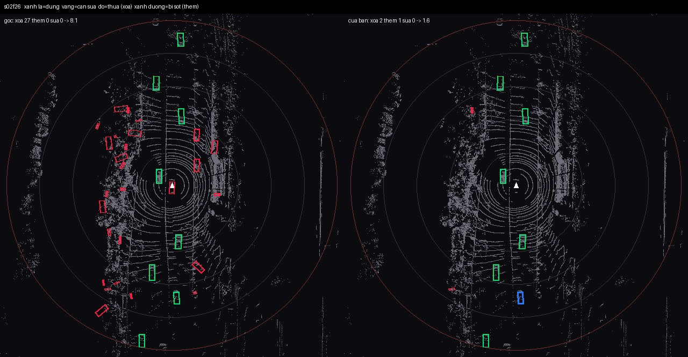

# Báo cáo Day 14 — Nguyễn Minh Hiếu — 2A202603089

- Mã học viên dùng với `--student`: `089`
- `seed_tag` trong `frames_A.txt`: `393590736f`

## 1. Dự đoán trước sweep (bước 5b)

Ghi **trước** khi chạy `scripts/pp_sweep.py`, rồi commit và push ngay (lịch sử commit là bằng chứng thời điểm viết). Không sửa phần này sau khi có kết quả.

- Tham số tôi nghĩ giảm công sửa nhiều nhất: `score_thr` và tăng `min_points`
- Vì box bị thừa nhiều, phần lớn chi phí đến từ xóa do pre label thừa.

## 2. Tập A: sửa tay và tune

| Cấu hình | Xóa | Thêm | Sửa | Chi phí |
|---|---:|---:|---:|---:|
| Gốc | 66 | 2 | 1 | 22.3 |
| `best_config.json` | 9 | 7 | 1 | 10.2 |

- Tham số đã đổi trong `best_config.json`: `score_thr` từ `0.1` → `0.5` (`min_points` giữ nguyên `0`).
- Kết quả leave-one-out (dán các dòng `scripts/pp_sweep.py` in ra):
```text
Leave-one-out (chọn trên các frame còn lại, chấm trên frame bỏ ra):
  s01f20: cấu hình chọn {'score_thr': '0.5', 'min_points': '0'} → 3.7 (tốt nhất có thể 3.3)
  s02f26: cấu hình chọn {'score_thr': '0.5', 'min_points': '0'} → 1.6 (tốt nhất có thể 1.5)
  s04f11: cấu hình chọn {'score_thr': '0.4', 'min_points': '10'} → 5.5 (tốt nhất có thể 4.9)
```
- Cấu hình có ổn định trên từng frame không? Vì sao tôi vẫn chọn (hoặc không chọn) nó: Khá ổn định — 2/3 lượt giữ nguyên `score_thr=0.5, min_points=0`, lượt `s04f11` chọn `score_thr=0.4, min_points=10` (chi phí toàn tập A là `10.30`, rất sát `10.20`). Tổng chi phí leave-one-out là `10.8` so với tối ưu từng frame `9.7` (chênh lệch nhỏ), nên vẫn chọn `best_config.json` làm cấu hình khởi điểm cho tập B.

## 3. Trước/sau (bước 8)



- `scripts/pp_compare.py` báo giảm **54%** công sửa trên tập A (`22.3` → `10.2`).
- Dự đoán ở mục 1 đúng hay sai? Giải thích bằng số box xóa/thêm/sửa: Đùng vì số box cần xóa giảm từtừ 66 còn 9, nhưng số box cần thêm tăng từ 2 lên 7. Cuối cùng thì chi phí vẫn giảm đáng kể.

## 4. Tập B

Số đo từ `scripts/pp_prelabel.py --frames d14_089/frames_B.txt --config d14_089/best_config.json --gt d14_089/ref_B.json`:

| Xóa | Thêm | Sửa | Chi phí |
|---:|---:|---:|---:|
| 35 | 2 | 1 | 13.0 |

- Loại box tốn công sửa nhất ở tập B: Tổng công sửa tập trung nhiều nhất ở việc **xóa box thừa** (`35` box, chiếm `10.5 / 13.0` chi phí); nếu xét riêng từng thao tác đơn lẻ thì **thêm box bị sót** (`2` box tại `s01f30` và `s05f25`, trọng số `1.0`/box) tốn công nhất trên mỗi box.

## 5. Giới hạn

- Tập tune A chỉ gồm **3 frame**, kích thước mẫu nhỏ nên tham số chọn được có thể chưa tối ưu đều cho mọi kịch bản khác nhau ở tập B.
- Model PointPillars pre-trained trên **KITTI** chỉ học 3 lớp (`Car`, `Cyclist`, `Pedestrian`), không có lớp `Truck`/`Bus` nên với xe lớn trên dữ liệu VinFast dễ nhận nhầm lớp hoặc tách thành nhiều box nhỏ.
- Chỉ số `correction_cost` (`0.3·xóa + 1.0·thêm + 0.5·sửa`) là công thức quy ước gần đúng, chưa phải thời gian thao tác thực tế đo trực tiếp trên giao diện CVAT 3D.
